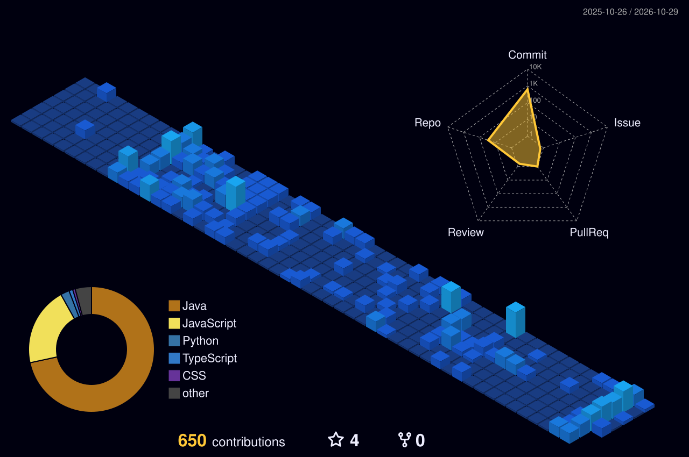

<!-- ═══════════════════════════ HEADER ═══════════════════════════ -->

 

<!-- Profile view counter (counts every load of this README) -->

---

  

---

## 🛠️ Toolbox

<table align="center">
  <tr>
    <td align="center" width="140"><b>Languages</b></td>
    <td></td>
  </tr>
  <tr>
    <td align="center"><b>Frontend</b></td>
    <td></td>
  </tr>
  <tr>
    <td align="center"><b>Backend</b></td>
    <td> &nbsp;</td>
  </tr>
  <tr>
    <td align="center"><b>Cloud & DevOps</b></td>
    <td> &nbsp;</td>
  </tr>
</table>

---

## 🏙️ My Commits, as a Skyline

  
  Every tower is a day of code. Taller means busier. Rebuilt daily by a GitHub Action.

---

## ⚡ Live Activity Feed

Auto-updated every few hours from my public GitHub events.

<!--START_SECTION:activity-->
<!--END_SECTION:activity-->

---

## 🐍 Watch the snake eat my contributions

  <picture>
    <source media="(prefers-color-scheme: dark)"  srcset="https://raw.githubusercontent.com/RamThokane/RamThokane/output/github-contribution-grid-snake-dark.svg" />
    <source media="(prefers-color-scheme: light)" srcset="https://raw.githubusercontent.com/RamThokane/RamThokane/output/github-contribution-grid-snake.svg" />
    
  </picture>

---

**Open to internships & collaborations in Full Stack, AI/ML and Cloud.**
 
If something here caught your eye, a ⭐ on a repo or a message on LinkedIn goes a long way.

